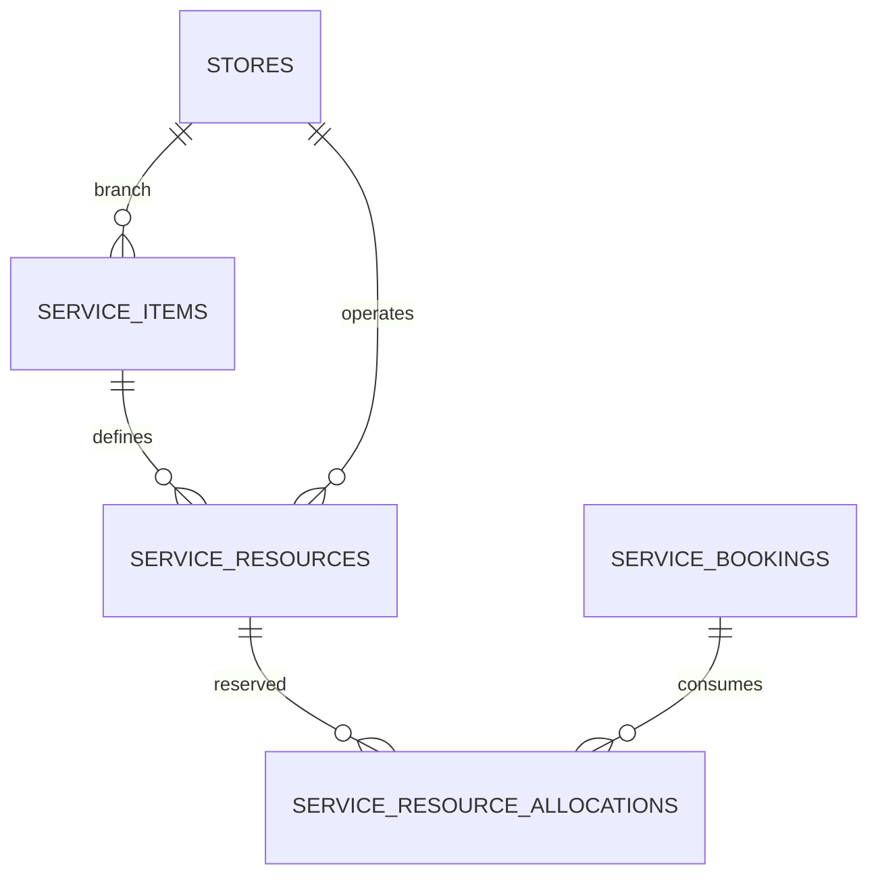

# Issue #42 — Service resource inventory and availability architecture

This is a **non-destructive foundation**, not an assertion that six service inventory modules are finished or that online inventory is live. The existing bike rental booking architecture is unchanged.

## Entities and cardinality

The new `service_resources` catalog stores **real, individually managed resource IDs**, type, branch, operating state and verified integer capacity. `service_resource_allocations` stores dated, per-booking allocations with quantities and temporary holds. Foreign keys protect historical references. No existing service bookings are rewritten by the migration.

## Resource types and next-service ownership

| Type | Service | Inventory and scheduling required in its service epic |
|---|---|---|
| `cab_vehicle` | Taxi | Vehicle license, class, trip assignments, driving time buffers |
| `cab_driver` | Taxi | Verified driver, shifts, time overlap and location |
| `boat` | Boating | Vessel, captain, shared seat vs private full-vessel charter |
| `scuba_slot` | Scuba | Session, boat, instructor, participant eligibility and equipment |
| `stay_room` | Homestay | Actual room unit and room-night check-in/out buffer |
| `tour_guide` | Guides | Individual verified guide, language and working calendar |
| `tour_departure` | Tours | Departure, seat limit, supplier dependencies and itinerary |

The above are **type-discriminated physical/resource records**, not separate production-ready cab, boat, scuba, homestay, guide or tour management systems. Each service epic must add its type-specific detail tables/constraints and admin CRUD. Type strings are validated by their application-level service modules before any admin publish or customer exposure; no public write route exists in this phase.

## Core invariants

1. Only operator-approved `status=available` resources can be allocated. An initial resource is draft.
2. Resource must belong to the same `service_item_id`, service type and branch as its booking. Legacy branchless services remain allowed when resource and booking are consistently branchless.
3. All writers use `ServiceResourceAllocator::allocate`, which locks the **resource row** in a DB transaction before summing overlapping allocations. The lock must be honored by every future writer.
4. Half-open intervals `[start,end)` permit same-time end/start handoffs (subject to buffer rules in each service module). Holds expire automatically for capacity calculation; `confirmed` allocations continue to reserve units.
5. Capacity is **numeric, explicit and verified**. Never convert "10 Persons" or a blank field to an imaginary default of 20 for newly managed resources.
6. A retry with same resource, booking, interval, quantity and status returns existing allocation. A changed retry fails. Unique keys prevent two copies for same booking/resource.
7. **No new records are seeded.** Existing `service_items` bookings continue through their legacy availability code; dual-write/migration is intentionally NOT enabled until the service-specific inventory is complete, data is reconciled and staging accepted.
8. `service_enquiries` are not bookings and do not allocate inventory or accept payments. Existing bike inventory uses separate `Bike`/`BikeModel` models.
9. Customer payment is prohibited until availability and server-derived pricing are both approved. Allocation alone does not imply a paid/confirmed booking.

## Remaining explicit work

- Implement cab classes/driver/vehicle data, boat departures, dive eligibility and instructors, property/room-night calendars, guide shifts, tour itinerary departure and shared cross-service supplier allocations in the relevant open issues.
- Add admin permissions and role-scoped CRUD for these resources before making them publishable.
- Implement atomic booking creation + allocation + server quote, appropriate resource conflict recovery and release/modify flows. Future migration must avoid double counting existing `ServiceBooking` capacity.
- Add production-database integration/concurrency tests (two separate connections/transactions), because the initial tests cover deterministic capacity boundaries, not a real parallel server race.
- Staging backup, migration `2026_11_07_000011`, manual seed of verified sample resources on staging only, test concurrency/branch restrictions, sign-off. No production deploy without approval.

## Rollout and rollback

1. Back up staging and verify `main` SHA.
2. `php83 artisan migrate:status`, then `php83 artisan migrate --force`.
3. Check `service_resources` and `service_resource_allocations` exist and initially contain zero rows. Existing service and bike booking totals must remain unchanged.
4. Do not manually fill resources with fake inventory. The first genuine resources will be created when service-specific admin CRUD is approved.
5. Rollback only with a verified backup and after confirming there are no genuine allocations (FK constraints intentionally restrict destructive removal).

The full implementation remains tracked by epic #27 and service epics #29–#34; **Issue #42 stays open until staging and broader capacity/authorization acceptance is recorded**.
